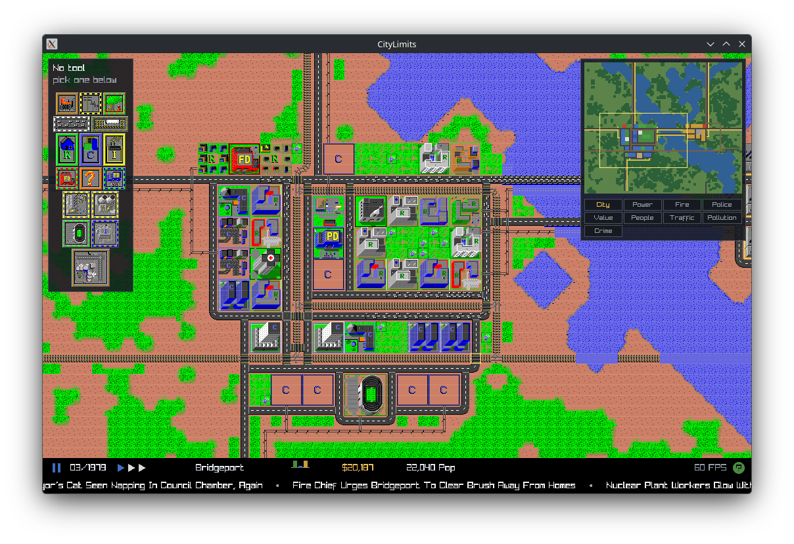

<p align="center">
    <picture>
      
    </picture>
  </a>
</p>

<h1 align="center">CityLimits</h1>

<p align="center">
  <b>An open source city simulation based on Micropolis</b><br>
</p>

City Limits is a re-imagining of SimCity Classic that brings modern city building concepts to the classic game.

## 🛠️ Building

CityLimits is written in Swift 6 with [raylib-swift](https://github.com/tonytins/raylib-swift)
and [Hudini](https://github.com/tonytins/Hudini). For now it builds on Linux,
with Swift 6.3 or later and the packages raylib needs for a window
(X11 or Wayland, and OpenGL).

```sh
swift build                 # build the game and its core
swift test                  # run the tests
swift run citylimits        # play
swift run citylimits --help # the command line: headless runs and scenarios
packaging/linux/package.sh  # build an AppImage and a .tar.gz into dist/release
```

[packaging/](packaging/README.md) says what the packages hold and which
systems they run on.

Up to 0.5, CityLimits was written in C#; that build lives on the
`legacy/csharp` branch, with its own instructions. See
[the documentation](docs/README.md) for playing, modding, and the file
formats.

## ⚖️ License

I license this project under the GPL-3.0 license - see [LICENSE](LICENSE) for details.